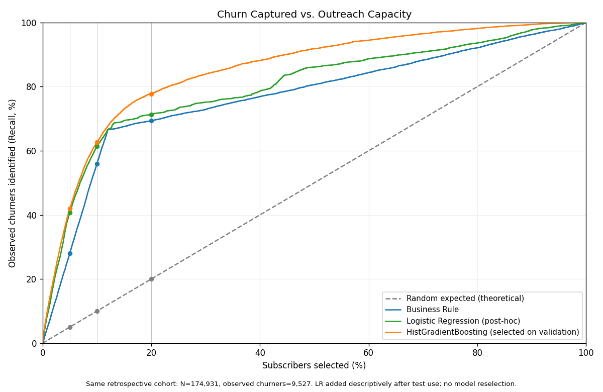

# Retention Lab

Compare business rules and machine learning to identify historical subscription
churners when outreach capacity is limited.



## Key result

The complete evaluation cohort contains **174,931 subscribers**, of whom
**9,527 were observed to churn**.

At **10% outreach capacity**, each strategy selects **17,493 subscribers**
from this cohort—not necessarily the same people. Recall@K measures the share
of all 9,527 observed churners included in each selection:

| Strategy | Recall@K |
|---|---:|
| Random expected | 10.00% (expected) |
| Business Rule | 55.91% |
| Logistic Regression | 61.35% |
| HistGradientBoosting (HGB) | **62.64%** |

HGB identifies **641 additional observed churners versus Business Rule** and
**123 versus Logistic Regression**, with the same selected-list size.
These are churners **identified, not churn prevented or customers retained**.

## Overview

The business question is not simply who may churn, but how much observed churn a
limited review list captures. Four strategies share the same held-out February
2017 KKBOX cohort, feature cutoff and outreach budgets. The comparison is a
restricted retrospective benchmark, not a historical campaign simulation.

## Interactive demo

The [React capacity explorer](web/README.md) provides a 0–100% capacity selector,
four curves, exact selected-list metrics, paired differences and conditional
bootstrap intervals at 5/10/20%. It reads public aggregates only: no backend,
subscriber records, model execution or scoring API.

```sh
cd web
npm ci
npm run dev
```

Use **Node 24**. For production and browser checks, see the [web guide](web/README.md).
**Ready for Netlify deployment — live verification pending.** There is no live
URL yet; deployment has not been performed.

## Methods and models

- Random selection is shown as its theoretical expectation, not a sampled run.
- Business Rule prioritizes recorded auto-renew off with deterministic ties.
- Logistic Regression and HistGradientBoostingClassifier use the same seven
  transaction-derived predictors; preprocessing fits on training only.
- HGB was selected on validation Recall@10% and frozen before the original
  three-strategy final evaluation. LR was added later from its original frozen
  ranking as a **descriptive post-hoc extension**, not independent confirmation.

Read the [problem definition](docs/problem_definition.md),
[methodology](docs/methodology.md), [feature contract](docs/features.md) and
[model guide](docs/models.md). The [evaluation history](docs/evaluation_history.md)
preserves the original protocol and its then-applicable restrictions.

## Tech stack

Python 3.12.3, pandas, NumPy, SciPy, scikit-learn and Matplotlib; nbclient/ipykernel
for the executed EDA notebook; standard-library unittest for Python checks.
React, TypeScript, Vite and Recharts; Vitest/Testing Library and Playwright/axe
for frontend verification. Netlify serves the static build only.

## Reproducibility

From the repository root, on the verified **CPython 3.12.3 / Linux x86_64** target:

```sh
python3.12 -m venv .venv
.venv/bin/python -m pip install -r requirements.txt
.venv/bin/python -m pip check
.venv/bin/python -m unittest discover -s tests -v
.venv/bin/python scripts/audit_kkbox_robustness.py
```

Tests and the public audit need no original KKBOX files. Do not overwrite an
existing environment. See [installation fallback and historical procedures](docs/methodology.md#reproduce)
for Python without ensurepip, private input requirements and experiment boundaries.
[`requirements.txt`](requirements.txt) pins the complete **Python** environment,
including transitive/notebook dependencies; it is not a cross-platform or hashed
wheel lock. The web has a separate npm manifest/lockfile and does not install it.

Explore the [executed EDA notebook](notebooks/01_eda.ipynb),
[Python source](src/retention_lab/), [scripts](scripts/) and [tests](tests/).
The final experiment is consumed: historical reproduction commands are not a
maintenance recipe to retrain, reselect or reopen final labels.

## Results and robustness

[Results](docs/results.md) explain the modest HGB–LR margin at 10% (+1.29 recall
percentage points), larger margin at 20%, and experimental chronology.
[The robustness audit](docs/robustness.md) reports 2,000 paired subscriber
bootstrap replicates conditional on frozen rankings, with pointwise intervals
only at 5/10/20%; it is post-hoc, not another independent test.

Public evidence: [comparison JSON](artifacts/capacity_comparison_v2.json),
[summary table](artifacts/capacity_comparison_v2.md),
[robustness JSON](artifacts/robustness_v1.json), and the
[pre-test freeze](artifacts/model_freeze.json). Historical development diagnostics
are not final evaluation results.

## Limitations

One company and 2017 cohort; no external or out-of-time validation. Event dates
are proxies for availability, exact label adjudication is unverified, and
eligibility is conditioned on supplied competition labels. Bootstrap intervals
do not include retraining/model-selection uncertainty or establish temporal
transferability. No causal retention benefit, campaign ROI or production
performance is demonstrated. See [classified limitations](docs/limitations.md).

## Data source and attribution

[WSDM 2018 — KKBOX Churn Prediction Challenge](https://www.kaggle.com/competitions/kkbox-churn-prediction-challenge)
([data](https://www.kaggle.com/competitions/kkbox-churn-prediction-challenge/data),
[rules](https://www.kaggle.com/competitions/kkbox-churn-prediction-challenge/rules)).
Independent educational project, not affiliated with or endorsed by KKBOX or
Kaggle. Obtain original CSVs through authorized access; none are redistributed.
Published artifacts are limited derived aggregates, not an assertion of express
permission to redistribute all data or derivatives. See [attribution and the
publication boundary](docs/data_attribution.md).

[Project specification](PROJECT.md) · [Roadmap](ROADMAP.md)
